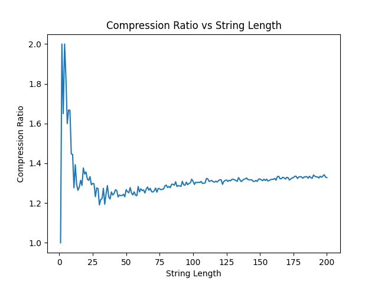

# Assignment 7: Associative Arrays and Applications

Benjamin Meyer

## Introduction

For this assignment, I implemented an associative array using a hash table. All code is in the `src/main/kotlin/` directory. I implemented a class for a fixed-size hash table in the `HashTable.kt` file, and used it as the underlying data structure for an associative array class in the `AssociativeArray.kt` file. The unit tests are in the `TestAssociativeArray.kt` file. The associative array is capable of rehashing if the load factor gets too large based on the list of good hash table primes provided in the assignment. This associative array is used to store a dictionary of bit strings to characters used for Lempel-Ziv encoding and decoding, both implemented in the `LempelZiv.kt` file along with a helper function for padding a bit string with 0s. I did my testing in the `Main.kt` file.

## Lempel-Ziv

I tested the effectiveness of the Lempel-Ziv compression on strings of various length in order to find how the compression ratio would change as strings grew in length. The compression ratio is defined as the size of the original file divided by the size of the compressed file, which we want to be as large as possible. A compression algorithm is ineffective if the ratio is less than 1, does nothing if the ratio is equal to 1, and is effective at values greater than 1. While I didn't actually save the files, I measured the size of the original string as the number of characters, assuming each character takes one byte. I measured the size of the compressed bit string as the ceiling of the total number of bits divided by 8, since there are 8 bits in a byte, and we can't store an incomplete byte. The ratio between those two values is the compression ratio. Each string tested was a randomly-generated sequence of characters, where the options were all capital Latin characters (A, B, C, ..., Z).

Lempel-Ziv does successfully compress a string at all lengths, with the compression ratio never being less than 1. It does nothing when there is just one character in the string, although I can't imagine anyone needs to compress a file of just one byte. It's most effective when there are fewer characters in the string, with compression ratios near 2 for smaller strings with 8 or fewer characters. I imagine this is due to the presence of fewer distinct characters being present, as larger numbers of distinct characters lead to longer codes that take up more space. That said, as the strings get longer, the compression ratio appears to plateau a bit above 1.3. This shows a successful compression that becomes slightly more effective as the string gets longer, but it also shows that the compressed strings can get a bit longer in their own right. This could be improved by using character codes of variable length and huffman coding to assign the shortest codes to the most frequent characters, but even without those extra steps, it's still successful in compressing text files to bit strings of smaller size.