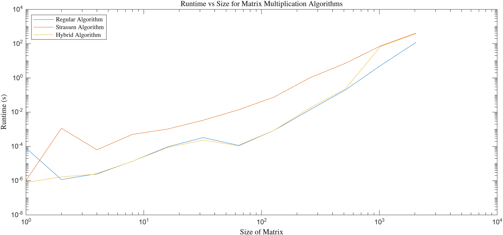

# Assignment 5: Divide and Conquer and Dynamic Programming
Benjamin Meyer

## Matrix Multiplication
I implemented the traditional matrix multiplication algorithm and the Strassen matrix multiplication algorithm in my `SquareMatrix` class, and ran unit tests in the `TestSquareMatrix.kt` file. Traditional matrix multiplication should be in $\Theta(n^3)$, and Strassen matrix multiplication should be in $\Theta(n^{log_27})$.  

However, the recursive call stack for the Strassen algorithm can add considerablly to the function's runtime, so for smaller matrices, the regular algorithm is actually faster. To take this into account, we can use a hybrid approach that performs traditional matrix mutliplication for smaller matrices and uses the Strassen algorithm only for much larger matrices. The runtimes of the traditional, Strassen, and hybrid algorithms for matrices of various sizes are shownn in Fig 1.

___Figure 1:__ A plot showing runtimes for the traditional, Strassen, and hybrid matrix multiplication algorithms vs the size of the matrices being multiplied with a log-log scale. The data can be found at `/src/main/resources/runtimeData.csv`._  

As can be seen in Figure 1, for matrix sizes up to 2048, traditional matrix multiplication actually has a faster runtime than the Strassen algorithm. However, as the matrix sizes get larger, the runtime of the traditional algorithm is increasing at a greater rate than that of the Strassen algorithm. This matches our expected outcome of the Strassen algorithm being faster in the long run, even if traditional matrix multiplication is faster for smaller matrices. The runtimes at sizes larger than 2048 are very long, which is why my recorded runtimes in the graph don't go beyond 2048. As I write this, I'm trying to get the average runtime for a matrix size of 4096, although my code has been running for several hours and the time may not wind up in my submission. Still, the pattern is visible, and it's clear that the Strassen algorithm will be better in the long run.  

In theory, for the hybrid algorithm, we would use traditional matrix multiplication when it's more efficient than the Strassen algorithm, and the Strassen algorithm for matrices large enough that Strassen us more efficient. However, I was unable to record runtimes for matrices for which Strassen would become more efficient due to their size, so I switched over from Strassen to traditional matrix multiplication when the matrix size was 1000 or less to show its impact graphically with the data I could gather. As expected, its runtime is similar to that of traditional matrix multiplication when the size is 1000 or less, and similar to the Strassen algorithm at larger sizes. One might expect it to be faster than Strassen at those sizes since the base case is that much larger, but the runtime for matrices with sizes smaller than 1000 is trivial enough that it doesn't make a noticeable difference. In theory, in the long run, the hybrid algorithm should be the fastest of the three.  

## Aligning Protein Sequences
I chose to implement the Needleman-Wunsch algorithm for global sequence alignment. It's implemented in the `AlignSequences.kt` file, and unit tested in `TestAlignSequences.kt`. When testing the provided _genomeSnippet_ sequence against the _testAgainst_ sequence, the resulting alignment has a score of __ and returns as follows:  

idk bro