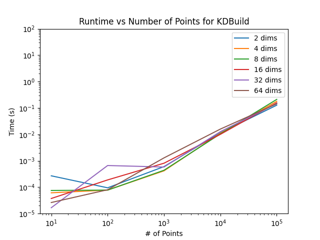
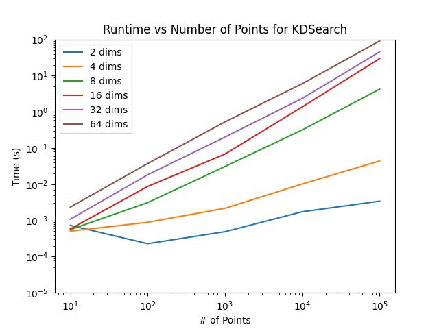
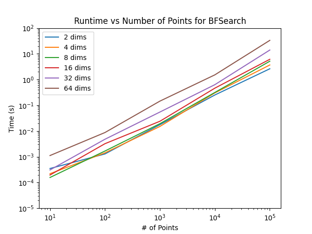

# Assignment 8: K-D Trees and Nearest Neighbor Search
Benjamin Meyer

## Introduction
For this assignment, I implemented two Nearest Neighbor Search (NNS) algorithms. The first implementation uses a K-D Tree, which is built using a QuickSelect algorithm (which I implemented) and then searched through to find a nearest neighbor. The second algorithm is a simple brute force search to find the closest element. All code is in the `src/main/kotlin/` directory. I implemented QuickSelect in `QuickSelect.kt`, I implemented both NNS algorithms in `NearestNeighborSearch.kt`, I implemented a benchmarking function in `Benchmarking.kt`, and I ran functions from the other files in `Main.kt`.

## K-D Tree Search vs Brute Force Search

    
    
    

The three figures all show runtime vs number of points, with each line representing samples taken with a different number of dimensions in each point. They are all log-log scale plots, meaning that an increase that visually appears linear is actually exponential. Searching through the K-D tree is theoretically more time-efficient than brute force search; however, it requires building a K-D tree first. This uses just one dimension per iteration, and recursively splits the data into halves until each list contains just one element. Each step uses the QuickSelect algorithm to find the median, which takes $\Theta(n)$ time. Per the master theorem ($T(n)=2T(\frac{n}{2})+n$), we would expect the overall tree-building algorithm to take $\Theta(n\ log\ n)$ time. This is not dependent on the number of dimensions $d$ at all, so it makes sense that the lines all appear very similar. There is a slight exponential increase in runtime as the number of points increases, which also makes sense. These times are small but non-trivial compared to search times, but it's also a one-time cost that only occurs before the first search, so K-D Tree search is most worthwhile when making large numbers of searches.

Searching using a brute-force algorithm always takes $\Theta(nd)$ time if $d$ is the number of dimensions, since we are comparing every dimension of every point to the query point. In contrast, searching through the K-D tree ideally takes $\Theta(log\ n)$ time if we just need to make one stop on each layer of the tree. However, if we reach a leaf and the query point is closer to a median than the found point, we will search through an alternate branch to make sure we've found the closest point. Thus, in the worst case, we would have to go through every single branch and compare every single point's Euclidean distance, giving a runtime of $\Theta(nd)$, similar to brute force search. The medians get much closer together at higher dimensionalities, so the time complexity of K-D Tree Search gets closer to $\Theta(nd)$ at higher dimensionalities, making it comparable to brute force search. This is visible in the plots, where we can see that points at 8 dimensions or above have runtimes very similar to brute force search. Brute force search is a bit faster at 8 dimensions, and significantly faster at 2 and 4 dimensions. They all have linear increases with time, however the curves are steeper for brute force search and high-dimensionality K-D Tree search than for low-dimensionality K-D Tree searching.

Thus, K-D searching is beneficial when you have to make a large number of searches, since the extra cost of making the K-D tree is applied just once. In addition, K-D search has a similar runtime to brute force searching at higher dimensionalities, so K-D Tree searching is only beneficial for $\leq8$-dimensional data. However, when K-D Tree searching is more effective, it's significantly more time-efficient than brute-force search, so it's absolutely worth implementing in those cases.